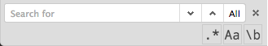

# CodeMirror Searchbox

Addon for [CodeMirror](http://codemirror.net "CodeMirror") for search and replace, same as [Ace](http://ace.c9.io/ "Ace") has.



# Install

```
npm i cm-searchbox --save
```

# How to use?

```js
var cm = CodeMirror(document.body, {
    searchbox: true
});
```

You can find more advanced usage example in [wiki](https://github.com/coderaiser/cm-searchbox/wiki).

## License

MIT
